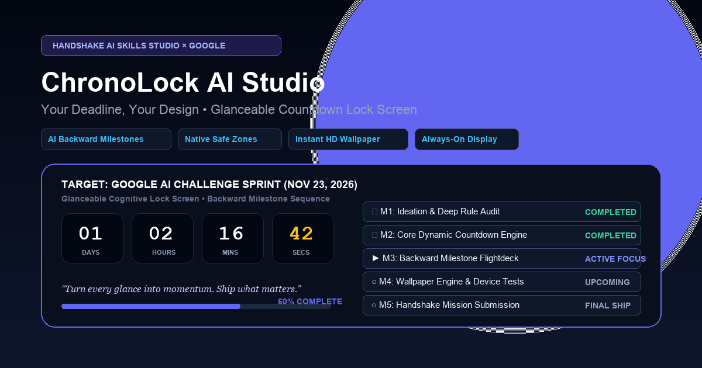

# ChronoLock AI Studio

> **Handshake AI Skills Studio × Google November Challenge Project**  
> *"Your Deadline, Your Design: Create a Countdown Lock Screen"*

[](https://vitejs.dev)
[](https://joinhandshake.com)



## ✨ Features
- **AI Backward Milestone Decomposition**: Deconstructs high-stakes deadlines into 5 tactical checkpoints leading backward from the target date using Google Gemini AI principles.
- **Glanceable Lock Screen Safe Zones**: Precision layout reserving unblocked negative space for iOS Dynamic Island, Android camera punch-holes, and system lock screen clocks.
- **Ticking Sub-Second Flightdeck**: High-contrast countdown grid displaying Days, Hours, Minutes, and pulsing Seconds.
- **1-Click High-Res Wallpaper Export**: Download PNG wallpapers at exact device resolutions for iPhone 16 Pro (1179×2556), Pixel 9 Pro (1280×2856), and 4K Desktop.
- **Fullscreen Always-On Display (AOD)**: Ambient nightstand/desk mode for phones, tablets, and laptops.
- **Calendar Synchronization**: Export `.ics` calendar files to push milestone alarms straight to Apple Calendar and Google Calendar.

## 🛠 Tech Stack
- **Framework:** React 18 + Vite 6
- **Styling:** Tailwind CSS v4 + Lucide Icons
- **Image Generation:** `html-to-image` + Canvas API + Pillow
- **AI Integration:** Google Gemini API integration (with heuristic fallback)

## 🏃 Quick Start
```bash
# Clone the repository
git clone https://github.com/pratikmohanty/chronolock-ai-studio.git
cd chronolock-ai-studio

# Install dependencies
npm install

# Start local development server
npm run dev
```
Open `http://localhost:5173` in your browser.
